# Request Flow Architecture
A breakdown of the serverless request lifecycle, authentication, asynchronous event processing, and monitoring pipeline shown in the system architecture.

---

```mermaid
flowchart LR
    %% Style Definitions matching diagram colors
    classDef clientNode fill:#162b42,stroke:#3b82f6,stroke-width:1.5px,color:#ffffff;
    classDef gwNode fill:#0d1b2a,stroke:#2563eb,stroke-width:2px,color:#ffffff;
    classDef lambdaNode fill:#072b34,stroke:#14b8a6,stroke-width:1.5px,color:#ffffff;
    classDef sqsNode fill:#241d08,stroke:#eab308,stroke-width:1.5px,color:#ffffff;
    classDef ddbNode fill:#2d1800,stroke:#f59e0b,stroke-width:2px,color:#ffffff;
    classDef cwNode fill:#261338,stroke:#a855f7,stroke-width:2px,color:#ffffff;
    classDef snsNode fill:#261338,stroke:#9333ea,stroke-width:1.5px,color:#ffffff;
    classDef tagNode fill:#15263a,stroke:#3b82f6,stroke-width:1px,color:#e2e8f0;
    classDef metricTag fill:#0d2f3d,stroke:#0284c7,stroke-width:1px,color:#38bdf8;

    %% 1. Client & Authentication Layer
    Client["Customer / API client"]:::clientNode
    Cognito["Amazon Cognito<br/>Sign up and sign in"]:::clientNode
    APIGW["API Gateway<br/>Validates Cognito token"]:::gwNode

    Client -->|"1. Sign in"| Cognito
    Cognito -->|"2. ID token"| Client
    Client -->|"3. API request + token"| APIGW
    APIGW -.->|"Order ID response"| Client

    %% 2. API Routes / Method Badges
    POST_Route["POST /orders"]:::tagNode
    Return_Badge["Return order ID"]:::tagNode
    GET_Route["GET /orders"]:::tagNode
    PATCH_Route["PATCH /status"]:::tagNode
    DELETE_Route["DELETE /orders"]:::tagNode

    APIGW --> POST_Route
    APIGW --> GET_Route
    APIGW --> PATCH_Route
    APIGW --> DELETE_Route

    %% 3. Lambda Processing Functions
    CreateLambda["Create Lambda<br/>sets customer ID from token"]:::lambdaNode
    ReadLambda["Read / List Lambda<br/>checks order ownership"]:::lambdaNode
    UpdateLambda["Update Lambda<br/>checks order ownership"]:::lambdaNode
    DeleteLambda["Delete Lambda<br/>checks order ownership"]:::lambdaNode

    POST_Route --> CreateLambda
    CreateLambda --> Return_Badge
    Return_Badge --> APIGW

    GET_Route --> ReadLambda
    PATCH_Route --> UpdateLambda
    DELETE_Route --> DeleteLambda

    %% 4. Database Layer (DynamoDB)
    DynamoDB[("DynamoDB<br/>Orders table")]:::ddbNode

    CreateLambda -->|"Save order"| DynamoDB
    ReadLambda -->|"Get / query own orders"| DynamoDB
    UpdateLambda -->|"Update own order"| DynamoDB
    DeleteLambda -->|"Update own order"| DynamoDB

    %% 5. Asynchronous Queue Processing (SQS & DLQ)
    CreateSQS["Create events SQS"]:::sqsNode
    WorkerLambda["Create event worker Lambda"]:::lambdaNode
    DLQ["Create events DLQ"]:::sqsNode

    CreateLambda -->|"Post create event"| CreateSQS
    CreateSQS --> WorkerLambda
    CreateSQS -->|"After 3 failed receives"| DLQ

    %% 6. Telemetry, Logs & CloudWatch
    CloudWatch["CloudWatch"]:::cwNode

    Metric_APIGW["4XX metrics"]:::metricTag
    Metric_Create["Logs and metrics"]:::metricTag
    Metric_Read["Logs and metrics"]:::metricTag
    Metric_Update["Logs and metrics"]:::metricTag
    Metric_Delete["Logs and metrics"]:::metricTag
    Metric_Worker["Logs and metrics"]:::metricTag
    Metric_DDB["Table metrics"]:::metricTag
    Metric_DLQ["Queue metrics / alerts"]:::metricTag

    APIGW -.-> Metric_APIGW -.-> CloudWatch
    CreateLambda -.-> Metric_Create -.-> CloudWatch
    ReadLambda -.-> Metric_Read -.-> CloudWatch
    UpdateLambda -.-> Metric_Update -.-> CloudWatch
    DeleteLambda -.-> Metric_Delete -.-> CloudWatch
    WorkerLambda -.-> Metric_Worker -.-> CloudWatch
    DynamoDB -.-> Metric_DDB -.-> CloudWatch
    DLQ -.-> Metric_DLQ -.-> CloudWatch

    %% 7. Alarm & Notification Pipeline
    SNS["SNS alert topic"]:::snsNode
    Email["Confirmed email subscription"]:::snsNode

    CloudWatch -->|"ALARM notification"| SNS
    SNS --> Email
```

## 1. Authentication & API Ingestion

1. **Sign-In / Token Issuance:**
   - The **Customer / API Client** authenticates with **Amazon Cognito** (`Sign up and sign in`).
   - Cognito returns an **ID / Access Token** to the client.
2. **API Invocation:**
   - The client sends HTTPS requests with the bearer token to **Amazon API Gateway**.
   - API Gateway validates the Cognito token prior to routing traffic to downstream backend services.

---

## 2. Synchronous CRUD Processing (Lambda & DynamoDB)

API Gateway routes requests according to HTTP methods to dedicated AWS Lambda functions, which enforce tenant/user isolation:

| Method & Route | Target Lambda | Responsibility | Database Operation |
|---|---|---|---|
| `POST /orders` | **Create Lambda** | Extracts customer ID from token; returns `Order ID` immediately | Saves order to **DynamoDB Orders table** |
| `GET /orders` | **Read / List Lambda** | Validates order ownership against customer ID | Queries/retrieves orders from DynamoDB |
| `PATCH /orders` | **Update Lambda** | Validates order ownership | Updates matching record in DynamoDB |
| `DELETE /orders` | **Delete Lambda** | Validates order ownership | Updates or deletes record in DynamoDB |

---

## 3. Asynchronous Event Pipeline

- **Event Publishing:** After persisting a new order, the **Create Lambda** publishes an event (`Post create event`) to the **Create events SQS** queue.
- **Background Worker:** The **Create event worker Lambda** consumes messages from the SQS queue to handle asynchronous tasks (e.g., fulfillment, third-party sync, or notifications).
- **Dead-Letter Handling:** If processing fails after 5 retry attempts (`After 5 failed retries`), messages are rerouted to the **Create events DLQ** (Dead-Letter Queue) to prevent data loss.

---

## 4. Observability & Alerting

- **Amazon CloudWatch:** Collects telemetry across all components:
  - **API Metrics** from API Gateway
  - **Logs & Metrics** from all Lambda functions
  - **Table Metrics** from the DynamoDB Orders table
  - **Queue Metrics / Alarm** from the Dead-Letter Queue (DLQ)
- **Notification Pipeline:**
  - CloudWatch triggers an alarm upon anomaly or DLQ message ingestion (`ALARM notification`).
  - Alerts are dispatched to an **SNS alert topic**, which notifies operators via a **confirmed email subscription**.

    