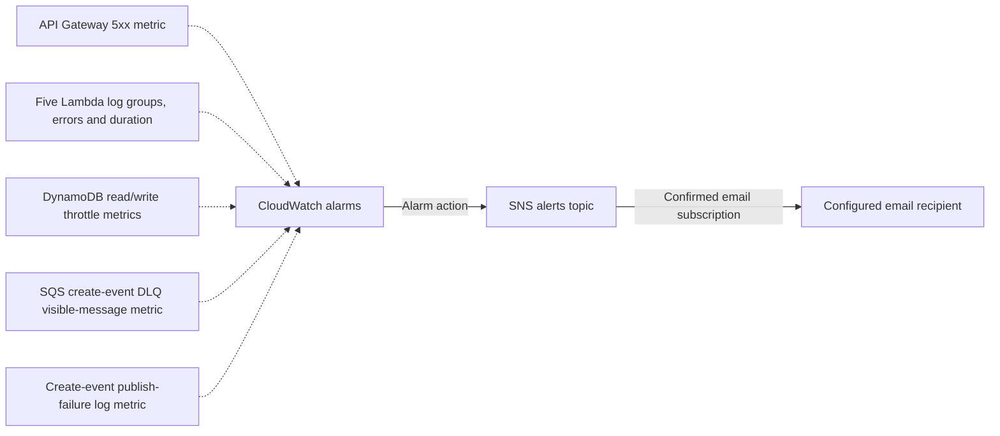

# Monitoring Design — OrderFlow Week 3

## Why Monitoring?

Monitoring helps detect failed or slow Lambda requests, API server errors, database throttling, and create events that became stuck in the DLQ. CloudWatch Logs help investigate what happened; CloudWatch alarms detect configured thresholds and notify the team through SNS email. This document describes resources configured by this project, not every monitoring feature AWS offers.

## Monitoring flow

The order API is customer-authenticated through Cognito, but Cognito sign-in events are **not** currently sent to CloudWatch or covered by alarms in this project.

## CloudWatch Alarms (Designed)

| Source | What CloudWatch receives or checks | Configured alarm |
| --- | --- | --- |
| Create, read, update, delete, and create-event worker Lambdas | Lambda invocation `Errors` and maximum `Duration`; function logs go to separate log groups | One error alarm and one duration alarm per function: **10 alarms total**. Duration threshold: 8,000 ms. Both evaluate a five-minute period. |
| API Gateway | API Gateway `5XXError` metric for the deployed API stage | Alarm when at least one 5xx is recorded in a five-minute period. |
| DynamoDB orders table | `ReadThrottleEvents` and `WriteThrottleEvents` table metrics | One alarm per throttle metric when at least one event is recorded in a five-minute period: **2 alarms**. |
| Create-event DLQ | SQS `ApproximateNumberOfMessagesVisible` for the dead-letter queue | Alarm when one or more messages are visible in a one-minute period. |
| Create Lambda log group | Metric filter matches `create_event_publish_failed` and emits a custom `CreateEventPublishFailures` metric | Alarm when a publish failure is recorded in a five-minute period. The order has already been saved; the API still returns the saved order. |

Terraform creates **15 alarms**: 10 for the five Lambda functions (one errors alarm and one duration alarm per function), 1 for API Gateway, 2 for DynamoDB throttling, 1 for DLQ messages, and 1 for create-event publish failures. It also creates one log metric filter that turns the publish-failure log entry into a metric.

## CloudWatch Log Groups Created

Terraform creates **five log groups**, one for each Lambda: create, read, update, delete, and create-event worker. Each group's name follows `/aws/lambda/<function-name>`.

The log-retention setting is shared by these five groups. It defaults to **14 days** and can be changed with Terraform variable `log_retention_days`. After the retention period, CloudWatch deletes expired log events. This retention period applies to these Lambda log groups; API Gateway access logs are not enabled in the project.

Each Lambda's IAM policy permits writes only to that function's log group. The create handler records order creation and logs `create_event_publish_failed` if it cannot publish the background event. The worker records a compact audit log after processing an `ORDER_CREATED` message. Avoid putting credentials or full sensitive order data in logs.

## Lambda log group names

Terraform creates a dedicated log group for each function:

- `/aws/lambda/orderflow-demo-create`
- `/aws/lambda/orderflow-demo-read`
- `/aws/lambda/orderflow-demo-update`
- `/aws/lambda/orderflow-demo-delete`
- `/aws/lambda/orderflow-demo-create-event-worker`

## Create-event failures and the DLQ

1. The Create Lambda saves the order to DynamoDB and returns its generated order ID to the API caller.
2. It then attempts to publish a compact `ORDER_CREATED` event to the create-events SQS queue.
3. The worker processes the event asynchronously. SQS invokes the worker one message at a time.
4. A failed worker invocation is retried. After **5 receives** without successful processing, SQS moves the message to the create-events DLQ.
5. CloudWatch alarms when a message is visible in the DLQ, then notifies SNS. The DLQ message remains available for investigation or redrive.

If publishing to SQS fails after the DynamoDB save, the order is still created and the caller still receives its order ID. The create Lambda logs the failure, and the log metric filter feeds the publish-failure alarm.

## SNS email notifications

All configured alarms use the same SNS alerts topic as their alarm action. The email recipient is set with Terraform variable `alarm_email`. The recipient must confirm the SNS subscription email once; after confirmation, alarm notifications are delivered when alarms enter `ALARM`. A `OK` alarm state means the configured threshold is not currently breached; it does not mean a new email is sent for every successful request.

## What is not configured

- API Gateway access or execution log groups. API Gateway is monitored by its 5xx metric alarm only.
- Cognito sign-in or authentication-event logs and alarms.
- A CloudWatch dashboard or AWS X-Ray tracing.
- A CloudWatch alarm for every possible metric or application error. In particular, the current custom log metric filter is for SQS publish failures; other Lambda errors are monitored through Lambda's built-in `Errors` metric.

## Where the configuration lives

The log groups, retention, metric filter, CloudWatch alarms, SNS topic, email subscription, and alarm actions are defined in [`../../week-2/terraform/main.tf`](../../week-2/terraform/main.tf). The log retention and email settings are declared in [`../../week-2/terraform/variables.tf`](../../week-2/terraform/variables.tf). The Lambda log and metric statements are emitted by the handlers under [`../../week-2/src/order_api/`](../../week-2/src/order_api/).

## Monitoring summary

| AWS service | Number of alarms | Alarm triggers when | Evaluation period |
| --- | ---: | --- | --- |
| Lambda — 5 functions | 10 (2 per function) | `Errors` is at least 1, or maximum `Duration` is at least **8,000 ms** | One data point within 5 minutes, per alarm metric |
| API Gateway | 1 | `5XXError` is at least 1 | One data point within 5 minutes |
| DynamoDB orders table | 2 | `ReadThrottleEvents` or `WriteThrottleEvents` is at least 1 | One data point within 5 minutes, per throttle metric |
| Create-events DLQ (SQS) | 1 | At least 1 message is visible in the DLQ | One data point within 1 minute |
| Create-event SQS publishing | 1 | The create Lambda logs `create_event_publish_failed` and the custom metric reaches 1 | One data point within 5 minutes |
| **Total** | **15** | Every alarm sends its alarm action to the SNS alerts topic | SNS email is delivered after the subscription is confirmed |

**Log groups:** 5 total, one for each Lambda. Each retains logs for **14 days by default**; Terraform variable `log_retention_days` controls the retention period.
