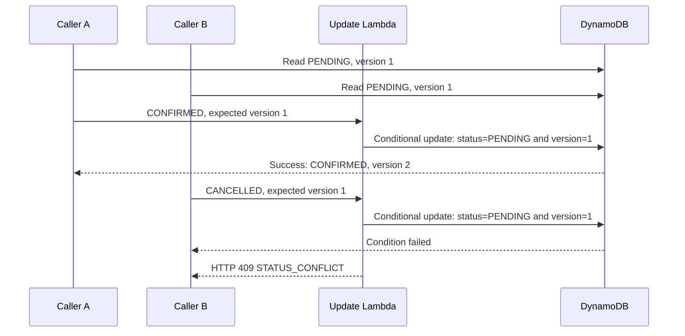
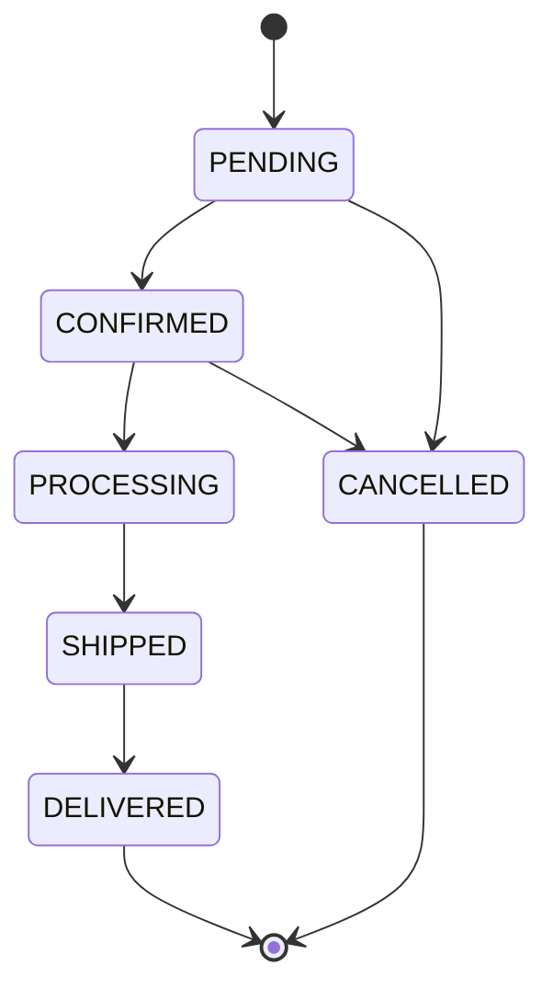

# Consistency and Failure Handling

## The Problem

Two customers or services can read the same order and try to update it at nearly the same time. For example, both read an order as `PENDING`, version `1`. One changes it to `CONFIRMED`; the other tries to cancel it using the old `PENDING`, version `1` data.

Without a concurrency check, the later write could overwrite the earlier change. The order might lose an update or end up in a state that no longer matches what the second caller saw. A valid transition by itself does not prevent this race: both changes might be valid from the old `PENDING` state.

## How We Prevent This — Optimistic Locking

The API requires the caller to provide the order's expected current status and version. The Update Lambda validates the requested transition, then DynamoDB applies the change only if the stored order still matches both expected values and belongs to the authenticated customer.

The update condition is equivalent to:

```text
order exists
AND customerId matches the signed-in customer
AND stored status equals expectedStatus
AND stored version equals expectedVersion
```

When the condition succeeds, DynamoDB changes the status, updates `updatedAt`, and increments `version` in the same atomic `UpdateItem` operation. No separate read-then-write gap is used to decide whether the write is safe.

### Example: Two updates race

1. Both callers read `PENDING`, version `1`.
2. Caller A requests `PENDING` → `CONFIRMED`, expected version `1`. The conditional write succeeds; the stored order becomes `CONFIRMED`, version `2`.
3. Caller B requests `PENDING` → `CANCELLED`, still expecting version `1`. DynamoDB's condition no longer matches, so the write is rejected. Caller B receives HTTP `409 STATUS_CONFLICT` and should retrieve the latest order before deciding what to do.



## State Machine Rules

An order starts in `PENDING`. Only the transitions below are allowed; `DELIVERED` and `CANCELLED` are terminal states.



The Update Lambda checks the requested transition before writing. For example, `DELIVERED` → `PROCESSING`, `CANCELLED` → `SHIPPED`, and `PENDING` → `DELIVERED` are rejected as invalid transitions. The allowed transitions are also listed in [`../../week-1/order-lifecycle/transition-rules.md`](../../week-1/order-lifecycle/transition-rules.md).

## How Errors Are Handled

| Condition | HTTP response | Project behavior |
| --- | --- | --- |
| Missing or invalid request fields/body, unknown status, invalid version, limit, or pagination token | `400 VALIDATION_ERROR` | Rejects the request with a specific validation message. |
| Known statuses but a forbidden state change | `400 INVALID_TRANSITION` | Rejects the transition before the DynamoDB update. |
| Missing or invalid Cognito token | `401 Unauthorized` | API Gateway authorizer rejects the request; the handler also checks the authenticated customer claim. |
| Order does not exist or belongs to a different customer | `404 ORDER_NOT_FOUND` | Returns the same not-found response so the API does not disclose another customer's order. |
| Stored status/version changed since the caller read the order | `409 STATUS_CONFLICT` | Does not overwrite the newer order; caller should retrieve the latest order before deciding whether to retry. |
| Unexpected Lambda or AWS service failure | `500 INTERNAL_ERROR` | Logs diagnostic details server-side and returns a generic response without exposing internal details. |

For a successful status update, the API returns `200` with the updated order and incremented version. The create endpoint returns `201` after the order is saved. The project does not automatically retry a conflicting API update with new values; the caller must first read the latest order.

The validation, transition, response, and conditional-update handling is implemented in [`../../week-2/src/order_api/common.py`](../../week-2/src/order_api/common.py).

## Other Consistency and Failure Protections

- **Order creation:** A generated `orderId` is written with a DynamoDB condition that rejects an item if that key already exists.
- **Order reads:** Reading an order by its primary key uses a strongly consistent DynamoDB read. Listing a customer's orders uses the `CustomerCreatedIndex` GSI, which is eventually consistent.
- **Customer ownership:** Reads, updates, and deletes check the authenticated Cognito customer ID. A customer cannot access another customer's order through the API.
- **Create event delivery:** The order is saved in DynamoDB before its event is sent to SQS. If sending the event fails, the order remains saved and the caller still receives its order ID; a log metric and CloudWatch alarm report the publish failure.
- **Worker failures:** SQS retries an unprocessed create event. After five receives, it moves the message to the DLQ; CloudWatch alarms when the DLQ contains a visible message.
- **Unexpected application errors:** The functions log server-side details and return a generic error response instead of exposing internal exception details to the API caller.

## Known Limitation

The create API does not currently use an idempotency key. If a client times out after the order was successfully saved and retries the same request, that retry can create a second order with a different generated ID. Add idempotency handling before relying on retries for payment or other side effects.
