# IAM Design — OrderFlow 

This document describes the IAM permissions used by the current Week 2 AWS deployment. Terraform configuration is in [`week-2/terraform/main.tf`](../../week-2/terraform/main.tf). Customer sign-in is handled by Amazon Cognito; customers do not use IAM credentials to call the API.

## Architecture diagram- IAM

```mermaid
flowchart LR
    %% Nodes
    Client["Customer / API client"]
    Cognito["Amazon Cognito"]
    APIGW["API Gateway"]

    CreateLambda["Create Lambda"]
    ReadLambda["Read / List Lambda"]
    UpdateLambda["Update Lambda"]
    DeleteLambda["Delete Lambda"]

    CreateRole["Create role<br/>Logs + DynamoDB PutItem<br/>SQS SendMessage"]
    ReadRole["Read role<br/>Logs + DynamoDB GetItem /<br/>Query"]
    UpdateRole["Update role<br/>Logs + DynamoDB GetItem /<br/>UpdateItem"]
    DeleteRole["Delete role<br/>Logs + DynamoDB DeleteItem"]

    DynamoDB[("DynamoDB orders table")]
    SQS["Create events SQS queue"]
    WorkerLambda["Create-event worker Lambda"]
    WorkerRole["Worker role<br/>Logs + SQS receive/delete"]
    DLQ["Create events DLQ"]

    Logs["CloudWatch Logs"]
    Alarms["CloudWatch alarms"]
    SNS["SNS alert topic"]
    Email["Confirmed email subscription"]

    %% Auth & API Gateway Flow
    Client -->|Sign in; receives JWT| Cognito
    Cognito -.->|Validates token| APIGW
    Client -->|API request + JWT| APIGW

    %% API Gateway to Lambdas
    APIGW -->|Route-specific invoke permission| CreateLambda
    APIGW -->|Route-specific invoke permission| ReadLambda
    APIGW -->|Route-specific invoke permission| UpdateLambda
    APIGW -->|Route-specific invoke permission| DeleteLambda

    %% Lambdas to Execution Roles
    CreateLambda -.->|Assumes its execution role| CreateRole
    ReadLambda -.->|Assumes its execution role| ReadRole
    UpdateLambda -.->|Assumes its execution role| UpdateRole
    DeleteLambda -.->|Assumes its execution role| DeleteRole

    %% Roles to DynamoDB
    CreateRole --> DynamoDB
    ReadRole --> DynamoDB
    UpdateRole --> DynamoDB
    DeleteRole --> DynamoDB

    %% Roles to CloudWatch Logs
    CreateRole --> Logs
    ReadRole --> Logs
    UpdateRole --> Logs
    DeleteRole --> Logs

    %% Async Event Processing Flow
    CreateRole --> SQS
    SQS --> WorkerLambda
    WorkerLambda -.->|Assumes its execution role| WorkerRole
    WorkerRole --> SQS
    WorkerRole --> Logs
    SQS -.->|Repeated failures| DLQ

    %% Monitoring & Alerting Flow
    DLQ --> Alarms
    Logs --> Alarms
    Alarms --> SNS
    SNS --> Email

    %% Styling
    classDef defaultFill fill:#1c2536,stroke:#4a5568,stroke-width:1.5px,color:#e2e8f0,rx:8,ry:8;
    classDef tealBorder fill:#1c2536,stroke:#4fd1c5,stroke-width:1.5px,color:#e2e8f0,rx:8,ry:8;
    classDef dbStyle fill:#1c2536,stroke:#d69e2e,stroke-width:1.5px,color:#e2e8f0;

    class Client,Cognito,APIGW,CreateRole,ReadRole,UpdateRole,DeleteRole,WorkerRole defaultFill;
    class CreateLambda,ReadLambda,UpdateLambda,DeleteLambda,SQS,WorkerLambda,DLQ,Logs,Alarms,SNS,Email tealBorder;
    class DynamoDB dbStyle;
```    

The image is the project's current IAM flow. The key distinction is that **Cognito authenticates customers**, while **IAM grants AWS identities permission to perform AWS actions**.

## Authentication and authorization

| Question | Project component | What it does |
| --- | --- | --- |
| Who is the customer? | Cognito user pool | Customer signs in and receives a JWT ID token. |
| Is the API request from a signed-in customer? | API Gateway Cognito authorizer | Validates the token before invoking a route's Lambda. |
| May this customer access this particular order? | Lambda business logic | Uses the validated Cognito `sub` claim as the customer identity and checks order ownership. |
| May an AWS service call another AWS service? | IAM role or resource permission | Grants narrowly scoped AWS actions, such as a Lambda writing to DynamoDB. |

Customers send the Cognito ID token with API requests. They do not receive IAM credentials and have no direct DynamoDB access. IAM is therefore **not** the customer login mechanism in this version.

## Lambda execution roles and permissions

Each Lambda assumes its own IAM execution role. The trust policy allows the Lambda service (`lambda.amazonaws.com`) to assume that role. The role's policies grant the function only the actions it needs, scoped to this project's table, index, queue, or log group.

| Execution role | AWS permissions in this project | Why it needs them |
| --- | --- | --- |
| Create Lambda | `dynamodb:PutItem` on the orders table; `sqs:SendMessage` on the create-events queue; `logs:CreateLogStream` and `logs:PutLogEvents` on its own log group | Saves an order, publishes its post-create event, and writes logs. |
| Read/List Lambda | `dynamodb:GetItem` and `dynamodb:Query` on the orders table and `CustomerCreatedIndex`; log-write actions on its own log group | Retrieves one order or queries a customer's orders without scanning the table. |
| Update Lambda | `dynamodb:GetItem` and `dynamodb:UpdateItem` on the orders table; log-write actions on its own log group | Reads and conditionally updates an order. |
| Delete Lambda | `dynamodb:DeleteItem` on the orders table; log-write actions on its own log group | Deletes an order. |
| Create-event worker Lambda | `sqs:ReceiveMessage`, `sqs:DeleteMessage`, and `sqs:GetQueueAttributes` on the create-events queue; log-write actions on its own log group | Consumes create events and records its execution logs. It has no DynamoDB policy in this project. |

The log groups are created by Terraform with retention configured. Lambda policies allow writing to each function's own log group; they do not grant broad access to every log group.

## API Gateway permission to invoke Lambda

IAM role policies control what a Lambda may call. Separately, each route has a Lambda **resource-based invoke permission** that allows the API Gateway service principal (`apigateway.amazonaws.com`) to invoke the Lambda connected to that route. The permission is scoped to the relevant API, stage, HTTP method, and path. This does not give API Gateway permission to read or write DynamoDB.

## Terraform deployment identity

When Terraform runs, the AWS CLI profile selected in the shell supplies the deployment identity. That IAM user or role needs permission to create, read, update, and—when destroying—delete the infrastructure managed by this Terraform configuration. This project does not create or define the policy attached to your AWS CLI identity. Use an appropriately scoped identity and keep credentials out of source control; do not paste access keys into this document or Terraform files.

## CloudWatch and SNS

Lambda execution roles can write function logs to CloudWatch Logs. Terraform configures CloudWatch alarms for application/service metrics and directs alarm notifications to the SNS topic. SNS emails go to the configured address only after its subscription is confirmed. These alarm actions are service integrations; they do not authenticate API customers.

## Least-privilege summary

- Keep a separate execution role for each Lambda so a read function cannot delete orders and a delete function cannot publish queue messages.
- Scope permissions to the specific DynamoDB table/index, SQS queue, and Lambda log group used by the function.
- Do not grant customers direct IAM or DynamoDB permissions.
- Keep order ownership checks in Lambda even though API Gateway validates Cognito tokens.
- Keep deployment permissions separate from runtime Lambda permissions.

## Where to inspect the configuration

- Lambda execution roles and inline policies: [`week-2/terraform/main.tf`](../../week-2/terraform/main.tf)
- Cognito user pool, app client, and API Gateway authorizer: [`week-2/terraform/main.tf`](../../week-2/terraform/main.tf)
- API Gateway-to-Lambda invoke permissions: [`week-2/terraform/main.tf`](../../week-2/terraform/main.tf)
- Customer identity and order ownership checks: [`week-2/src/order_api/common.py`](../../week-2/src/order_api/common.py)

