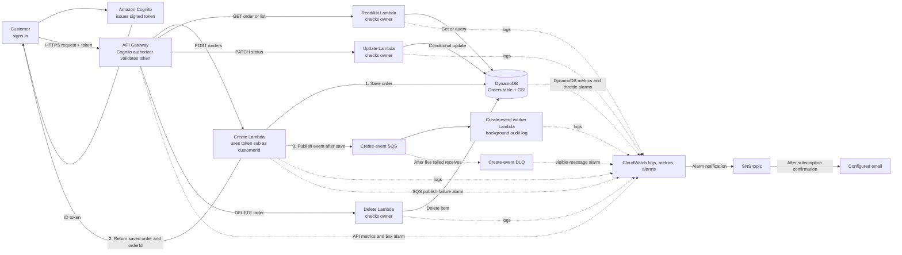

# OrderFlow AWS Deployment & Testing Guide

A step-by-step PowerShell guide to deploy the OrderFlow infrastructure using Terraform, authenticate with Amazon Cognito, test the API endpoints, inspect CloudWatch logs, and clean up resources.


## Phase 1: AWS & Terraform Setup

### Step 1: Navigate to the Terraform Directory

```
# Move from the project root into the terraform configuration folder
cd terraform

```

### Step 2: Configure AWS Profile & Environment

```
# Set up your AWS Access Key, Secret Key, and default region (eu-central-1)
aws configure --profile orderflow

# Set environment variables so AWS CLI and Terraform use this profile automatically
$env:AWS_PROFILE = "orderflow"
$env:AWS_DEFAULT_REGION = "eu-central-1"

# Verify that your credentials are active and pointing to the right AWS account
aws sts get-caller-identity
aws sts get-caller-identity --profile orderflow

```

### Step 3: Create and Select the Terraform Workspace

```
# Create a dedicated 'aws' workspace to isolate state files (ignore error if it already exists)
terraform workspace new aws

# Switch to the 'aws' workspace and confirm it is active
terraform workspace select aws
terraform workspace show

```

### Step 4: Initialize, Format-Check, and Validate Terraform

```
# Double-check that you are on the 'aws' workspace
terraform workspace show

# Download required AWS provider plugins and initialize the backend
terraform init

# Verify that all .tf files follow standard formatting rules
terraform fmt -check

# Check configuration syntax and internal consistency
terraform validate

```

### Step 5: Generate and Review the Execution Plan

> **Note:** Ensure your local `terraform.tfvars` (git-ignored) defines `alarm_email` for the SNS subscription. After deployment, check your email and click the AWS confirmation link to activate alarm notifications.

```
# Preview all 72 resources Terraform will create before making actual changes
terraform plan -var-file="aws.tfvars.example"

```

**Expected Output Summary:**

* `Plan: 72 to add, 0 to change, 0 to destroy.`

* Outputs generated: `api_url`, `cognito_app_client_id`, `cognito_user_pool_id`, `create_event_dlq_name`, `create_event_queue_name`, `lambda_names`, and `orders_table_name`.

### Step 6: Apply the Infrastructure Deployment

```
# Provision DynamoDB, API Gateway, Lambda functions, SQS/DLQ, CloudWatch alarms, and Cognito
terraform apply -var-file="aws.tfvars.example"

```

## Phase 2: Capture Outputs & Verify Cognito

### Step 7: Save Terraform Outputs to PowerShell Variables

```
# Store deployment outputs in variables for upcoming CLI and API commands
$apiUrl = terraform output -raw api_url
$clientId = terraform output -raw cognito_app_client_id
$poolId = terraform output -raw cognito_user_pool_id
$region = "eu-central-1"

```

### Step 8: Verify the Cognito User Pool Client & Return to Root

```
# Confirm the Cognito User Pool and App Client exist in AWS
aws cognito-idp describe-user-pool-client `
  --region $region `
  --profile orderflow `
  --user-pool-id $poolId `
  --client-id $clientId `
  --query "UserPoolClient.{PoolId:UserPoolId,ClientId:ClientId}" `
  --output table

# Return to the project root folder
cd ..

```

### Step 9: Verify Working Directory

```
# Confirm your prompt ends in the root project folder (e.g., ...\week-2>)
Get-Location

```

## Phase 3: Cognito User Registration & Authentication

### Step 10: Sign Up a New Cognito User

```
# Prompt for email and password securely (password is hidden while typing)
# Password rules: 12+ chars, uppercase, lowercase, number, symbol (avoid commas)

$email = Read-Host "Customer email"
$securePassword = Read-Host "Choose a password" -AsSecureString

# Convert SecureString to plain text in memory for the AWS CLI command
$ptr = [Runtime.InteropServices.Marshal]::SecureStringToBSTR($securePassword)
$password = [Runtime.InteropServices.Marshal]::PtrToStringBSTR($ptr)
[Runtime.InteropServices.Marshal]::ZeroFreeBSTR($ptr)

# Register the user in Cognito
aws cognito-idp sign-up `
  --region $region `
  --client-id $clientId `
  --username $email `
  --password $password `
  --user-attributes "Name=email,Value=$email"

```

### Step 11: Confirm the User Account

```
# Check your email (including spam) for the 6-digit verification code
$confirmationCode = Read-Host "Email confirmation code"

# Verify the user account in Cognito
aws cognito-idp confirm-sign-up `
  --region $region `
  --client-id $clientId `
  --username $email `
  --confirmation-code $confirmationCode

```

### Step 12: Sign In and Retrieve the JWT ID Token

```
# Authenticate using USER_PASSWORD_AUTH flow
$authJson = aws cognito-idp initiate-auth `
  --region $region `
  --client-id $clientId `
  --auth-flow USER_PASSWORD_AUTH `
  --auth-parameters "USERNAME=$email,PASSWORD=$password"

# Parse JSON response and extract the IdToken
$authResult = $authJson | ConvertFrom-Json
$idToken = $authResult.AuthenticationResult.IdToken

# Verify token retrieval (must be greater than 0; if 0, see Troubleshooting Step X)
$idToken.Length

```

## Phase 4: API Endpoint Testing (CRUD & Edge Cases)

### Step 13: Create Orders (`POST /orders` — Expected: `HTTP 201`)

```
# Create Order #1 (save the returned orderId from the JSON response)

$body = @{ items = @(@{ productId = "P300"; quantity = 2 }); totalAmount = 10.00 } |
  ConvertTo-Json -Depth 5 -Compress

$body | python examples/request_api.py POST "$apiUrl/orders" --token $idToken --body-stdin

# Create Order #2 with different items (generates a second unique orderId)

$body = @{
    items = @(@{ productId = "P200"; quantity = 1 })
    totalAmount = 19.50
} | ConvertTo-Json -Depth 5 -Compress

$body | python examples/request_api.py POST "$apiUrl/orders" --token $idToken --body-stdin

```

### Step 14: Get a Specific Order (`GET /orders/{id}` — Expected: `HTTP 200`)

```
# Replace with an actual orderId returned in Step 13
$orderId = "PASTE_THE_ORDER_ID_HERE"

# Fetch the single order details
python examples/request_api.py GET "$apiUrl/orders/$orderId" --token $idToken

```

### Step 15: List All Customer Orders (`GET /orders` — Expected: `HTTP 200`)

```
# Retrieve up to 20 orders belonging to the signed-in customer
python examples/request_api.py GET "$apiUrl/orders?limit=20" --token $idToken

```

### Step 16: Update Order Status (`PATCH /orders/{id}/status` — Expected: `HTTP 200`)

```
# Transition a newly created order from PENDING (version 1) to CONFIRMED
$orderId = "PASTE_THE_ORDER_ID_HERE"

$body = @{
    expectedStatus  = "PENDING"
    expectedVersion = 1
    newStatus       = "CONFIRMED"
} | ConvertTo-Json -Compress

$body | python examples/request_api.py PATCH "$apiUrl/orders/$orderId/status" --token $idToken --body-stdin

```

### Step 17: Test Invalid State Transition (`HTTP 400`)

```
# Attempting to jump directly from PENDING to DELIVERED violates business rules
$orderId = "PASTE_THE_ORDER_ID_HERE"

$body = @{ expectedStatus = "PENDING"; expectedVersion = 1; newStatus = "DELIVERED" } | ConvertTo-Json -Compress
$body | python examples/request_api.py PATCH "$apiUrl/orders/$orderId/status" --token $idToken --body-stdin

```

### Step 18: Delete an Order (`DELETE /orders/{id}` — Expected: `HTTP 200`)

```
# Permanently remove a specific order by ID
$orderId = "PASTE_THE_ORDER_ID_HERE"
python examples/request_api.py DELETE "$apiUrl/orders/$orderId" --token $idToken

```

### Step 19: Test Optimistic Locking / Stale Update (`HTTP 409`)

```
# Use an orderId from a newly created order (status: PENDING, version: 1)
$orderId = "PASTE_ORDER_ID_HERE"

# First update: succeeds with HTTP 200 and increments version to 2
$body = @{ expectedStatus = "PENDING"; expectedVersion = 1; newStatus = "CONFIRMED" } | ConvertTo-Json -Compress
$body | python examples/request_api.py PATCH "$apiUrl/orders/$orderId/status" --token $idToken --body-stdin

# Second update using stale version 1: fails with HTTP 409 STATUS_CONFLICT
$body = @{ expectedStatus = "PENDING"; expectedVersion = 1; newStatus = "CONFIRMED" } | ConvertTo-Json -Compress
$body | python examples/request_api.py PATCH "$apiUrl/orders/$orderId/status" --token $idToken --body-stdin

# Optional: inspect current status and incremented version
python examples/request_api.py GET "$apiUrl/orders/$orderId" --token $idToken

```

### Step 20: Test Missing Order (`HTTP 404`)

```
# Querying a non-existent order ID should return 404 Not Found
python examples/request_api.py GET "$apiUrl/orders/does-not-exist-12345" --token $idToken

```

### Step 21: Test Unauthorized Request (`HTTP 401`)

```
# Calling the API without an Authorization token should return 401 Unauthorized
try {
    Invoke-RestMethod -Method Get -Uri "$apiUrl/orders"
} catch {
    # Print the numeric HTTP status code (401)
    $_.Exception.Response.StatusCode.value__
}

```

## Phase 5: Monitoring, Logs & Cleanup

### Step 22: View CloudWatch & Terraform Logs

```
cd terraform

# Stream live logs for the 'create' Lambda (press Ctrl+C to stop)
# Hint: Replace 'create' with 'read', 'update', 'delete', or 'create-event-worker' for other functions
aws logs tail "/aws/lambda/orderflow-demo-create" --since 30m --follow --profile orderflow --region eu-central-1

# List all OrderFlow Lambda log groups in CloudWatch
aws logs describe-log-groups --log-group-name-prefix "/aws/lambda/orderflow-demo-" --query "logGroups[].logGroupName"

# Optional: Enable verbose Terraform debugging logs in PowerShell
$env:TF_LOG = "INFO"   # Use "DEBUG" for maximum verbosity
terraform plan -var-file="aws.tfvars.example"

# Always turn off Terraform verbose logging afterward
Remove-Item Env:TF_LOG

```

### Step 23: Destroy All Infrastructure

```
# Ensure you are inside the 'terraform' directory before running destroy
terraform destroy -var-file="aws.tfvars.example"

```

## Troubleshooting

### Step X: Reset Forgotten or Exposed Cognito Password

If sign-in failed (`$idToken.Length` is `0`) or your password appeared in terminal error output, reset it immediately:

```
# 1. Trigger a password reset email
aws cognito-idp forgot-password --region $region --client-id $clientId --username $email

# 2. Enter the reset code and a new password (avoid commas in password)
$code = Read-Host "Password reset code"
$securePassword = Read-Host "Choose a new password" -AsSecureString
$ptr = [Runtime.InteropServices.Marshal]::SecureStringToBSTR($securePassword)
$newPassword = [Runtime.InteropServices.Marshal]::PtrToStringBSTR($ptr)
[Runtime.InteropServices.Marshal]::ZeroFreeBSTR($ptr)

# 3. Confirm the new password
aws cognito-idp confirm-forgot-password `
  --region $region `
  --client-id $clientId `
  --username $email `
  --confirmation-code $code `
  --password $newPassword

# 4. Update local variable and sign in again
$password = $newPassword
$authJson = aws cognito-idp initiate-auth `
  --region $region `
  --client-id $clientId `
  --auth-flow USER_PASSWORD_AUTH `
  --auth-parameters "USERNAME=$email,PASSWORD=$password"

$authResult = $authJson | ConvertFrom-Json
$idToken = $authResult.AuthenticationResult.IdToken
$idToken.Length

```

### Step Y: Refresh Cognito IDs & Resend Sign-Up Confirmation Code

If you opened a new terminal session or missed your initial sign-up email:

```
# 1. Reload Cognito Pool ID and Client ID from Terraform outputs
Set-Location terraform
$poolId = terraform output -raw cognito_user_pool_id
$clientId = terraform output -raw cognito_app_client_id
cd ..
$region = "eu-central-1"

# 2. Request a new sign-up verification code
aws cognito-idp resend-confirmation-code `
  --region $region `
  --client-id $clientId `
  --username $email `
  --query CodeDeliveryDetails `
  --output json

# 3. Enter the newest sign-up code (do not use a password-reset code)
$signupCode = Read-Host "Sign-up confirmation code"

aws cognito-idp confirm-sign-up `
  --region $region `
  --client-id $clientId `
  --username $email `
  --confirmation-code $signupCode

```